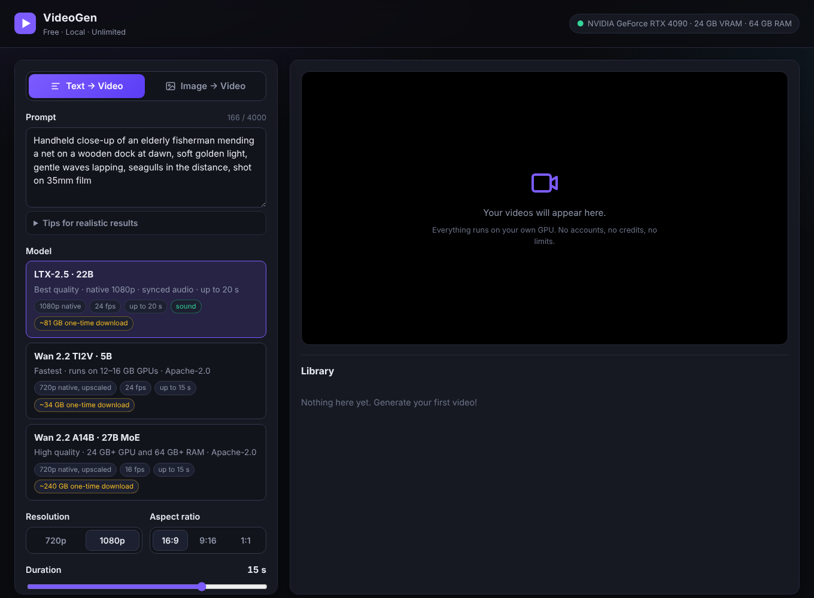

# VideoGen

**Free, local, unlimited AI video generation**: text → video and image → video, up to 1080p and 15–20 seconds, using the best open-weight video models of 2026. Everything runs on your own GPU: no accounts, no credits, no watermarks, no usage limits.



## What you get

| | **LTX-2.5** (default) | **Wan 2.2 TI2V-5B** | **Wan 2.2 A14B** |
|---|---|---|---|
| Best for | Highest quality, sound | Smaller GPUs, speed | Motion realism |
| Text → video / image → video | ✅ / ✅ | ✅ / ✅ | ✅ / ✅ |
| Resolution | **native 1080p** (two-stage) | 720p native → upscaled to 1080p | 720p native → upscaled to 1080p |
| Length per clip | **up to 20 s** in one pass | up to 15 s (chained 5 s segments) | up to 15 s (chained 5 s segments) |
| Frame rate | 24 fps | 24 fps | 16 fps (optional interpolation) |
| Synchronized audio | ✅ speech, effects, ambience | – | – |
| Recommended GPU | 24 GB+ VRAM, 64 GB RAM | 12–16 GB+ VRAM, 32 GB RAM | 24 GB+ VRAM, 64 GB+ RAM |
| One-time download | ~81 GB | ~34 GB | ~240 GB |
| License | [LTX-2 Community License](https://huggingface.co/Lightricks/LTX-2.5-Diffusers): free for individuals and companies under $10M revenue | Apache-2.0 | Apache-2.0 |

All three are loaded through 🤗 diffusers. VideoGen picks memory settings (CPU offloading, 8-bit/4-bit weights) automatically from your VRAM, so the same app runs on a 4090, a 5090, an A6000 or an H100.

**Features:** web UI with a job queue and video library, prompt enhancement (LTX), reference-image cropping with automatic aspect ratio, 16:9 / 9:16 / 1:1, seeds, "continue from last frame" to chain clips beyond 20 s, Lanczos or Real-ESRGAN upscaling, optional motion interpolation to 30/48/60 fps, H.264 MP4 with AAC audio, a CLI and a REST API.

## How "free and unlimited" works

Hosted generators charge credits because GPUs cost money. VideoGen downloads open-weight models once and runs them on **your** hardware, so the only cost is electricity and every generation is unlimited. The models are free to use: Wan 2.2 under Apache-2.0, and LTX-2.5 free unless your company earns more than $10M a year.

Free cloud notebooks (Colab, Kaggle) are not a good fit. They have usage quotas, and their T4/P100 GPUs have too little memory and no bfloat16 support for these models.

## Requirements

- **GPU:** NVIDIA RTX 3090 / 4090 / 5090 or a workstation/datacenter card with **24 GB+ VRAM** for 1080p. 12–16 GB cards (RTX 4070 Ti Super, 4080, 5070 Ti, 5080) can run Wan 5B, and LTX with 4-bit weights at 720p. RTX 20-series and older lack bfloat16 and are not recommended. Apple Silicon (M2/M3/M4 Max/Ultra, 64 GB+) works via MPS, slowly.
- **NVIDIA driver 580+** for the default CUDA 13 PyTorch build (older drivers: `TORCH_CUDA=cu126 ./install.sh`).
- **RAM:** 32 GB minimum, 64 GB+ recommended (offloaded weights live in system RAM).
- **Disk:** 35 GB (Wan 5B) to ~360 GB (all models); an SSD makes loading much faster.
- **Python 3.10–3.13.** ffmpeg is used if installed, otherwise a bundled copy.

## Install

```bash
git clone https://github.com/liikle/VideoGen.git
cd VideoGen
./install.sh          # Windows: install.bat
```

The installer creates `.venv`, installs PyTorch for your GPU, then installs VideoGen.

**LTX-2.5 needs a one-time license click** (free, instant):

1. Open <https://huggingface.co/Lightricks/LTX-2.5-Diffusers> and click **Agree and access repository** (you need a free Hugging Face account).
2. Create a read token at <https://huggingface.co/settings/tokens>.
3. Run `.venv/bin/hf auth login` (Windows: `.venv\Scripts\hf auth login`) and paste the token.

The Wan models need no login.

**Optional:** download weights ahead of time instead of on first use:

```bash
.venv/bin/videogen download ltx          # or: wan-5b, wan-14b, realesrgan, all
```

## Run

```bash
./run.sh              # Windows: run.bat
```

Open **http://localhost:7860**. Write a prompt (or switch to *Image → Video* and drop in a picture), pick a model, a resolution and a duration, then click **Generate**. Jobs queue up and run one at a time; finished videos stay in the library across restarts and are stored in `./outputs/<job-id>/video.mp4`.

> **Tip:** start with **720p / 5 s** to check your setup and get a feel for speed, then go to 1080p / 15 s. Generation takes minutes, not seconds. Time grows with duration × resolution, and the first job also loads the model into memory.

### Docker

```bash
HF_TOKEN=hf_xxx docker compose up --build    # needs the NVIDIA Container Toolkit
```

Weights and videos are kept in `./data`.

### Prompting for realism

- Describe **subject, action, setting, camera and light**: *"Handheld close-up of an elderly fisherman mending a net on a wooden dock at dawn, soft golden light, gentle waves lapping, seagulls in the distance, shot on 35mm film."*
- Film language helps realism: lens (35mm, 85mm), depth of field, camera moves (dolly-in, drone, handheld), lighting (golden hour, overcast, neon).
- For image → video, describe the **motion**; the image already defines the look.
- LTX generates sound from the prompt: mention it, including dialogue (*she says: "we made it"*).
- Keep **Enhance prompt** on for LTX: a small language model expands short prompts into the detailed captions LTX was trained on. The expanded text is shown under each video.

## Command line

```bash
# text to video, 15 s 1080p with sound
videogen generate "A red fox trotting through fresh snow in a pine forest at sunrise, cinematic" -d 15 -o fox.mp4

# image to video with the aspect ratio taken from the image
videogen generate "The waves roll in and the camera slowly pushes forward" -i beach.jpg -a auto -d 10

# Wan 5B on a 16 GB card, 720p vertical
videogen generate "A skateboarder lands a kickflip at golden hour" -e wan-5b -r 720p -a 9:16 -d 8

videogen info         # detected GPU, which models are downloaded, chosen memory plan
videogen serve --host 0.0.0.0 --port 7860     # LAN access (set VIDEOGEN_PASSWORD!)
```

## REST API

Interactive docs are at `http://localhost:7860/api/docs`.

```bash
curl -F prompt="A hummingbird hovering at a flower, macro, slow motion" -F duration=6 -F resolution=1080p \
     http://localhost:7860/api/jobs                       # -> {"id": "...", "status": "queued", ...}
curl http://localhost:7860/api/jobs/<id>                  # progress, then video_url when done
curl -F prompt="She turns and smiles" -F image=@portrait.png -F aspect=auto http://localhost:7860/api/jobs
```

## Configuration

Settings are environment variables (all optional):

| Variable | Default | Meaning |
|---|---|---|
| `VIDEOGEN_OFFLOAD` | `auto` | `none` (all on GPU, fastest), `model` (sub-models moved to GPU when used), `sequential` (layer streaming, lowest VRAM, slow) |
| `VIDEOGEN_QUANTIZE` | `auto` | `none`, `int8`, `nf4` (4-bit). Smaller weights fit smaller GPUs at a small quality cost |
| `VIDEOGEN_DEFAULT_ENGINE` | `ltx` | `ltx`, `wan-5b` or `wan-14b` |
| `VIDEOGEN_OUTPUT_DIR` | `outputs` | Where videos are saved |
| `VIDEOGEN_HOST` / `VIDEOGEN_PORT` | `127.0.0.1` / `7860` | Web server address |
| `VIDEOGEN_PASSWORD` | – | Require HTTP basic auth (any username) |
| `VIDEOGEN_LTX_PROMPT_ENHANCER` | `1` | Set `0` to skip the ~10 GB prompt-enhancer download |
| `VIDEOGEN_LTX_MODEL` etc. | official repos | Point an engine at a different diffusers repo |
| `HF_HOME` | `~/.cache/huggingface` | Where model weights are stored |
| `HF_TOKEN` | – | Hugging Face token (alternative to `hf auth login`) |

Automatic memory plans by VRAM (weights are moved to the GPU per sub-model unless noted):

| Model | Plan |
|---|---|
| LTX-2.5 | 60 GB+: bf16 · 32–60 GB: 8-bit · 16–32 GB: 4-bit (720p recommended below 24 GB) · under 16 GB: layer streaming (slow) |
| Wan 5B | 40 GB+: bf16, everything on GPU · 16–40 GB: bf16 · 10–16 GB: 8-bit · under 10 GB: layer streaming |
| Wan A14B | 40 GB+: bf16 · 24–40 GB: 8-bit · 14–24 GB: 4-bit · under 14 GB: layer streaming |

## How it works

- **LTX-2.5** uses Lightricks' distilled two-stage recipe. Stage 1 runs 8 denoising steps at half resolution (960×544 for 1080p). A latent upsampler doubles it, and stage 2 refines at 1920×1088 in 3 steps; the extra 8 rows are cropped to 1080. Video and audio are generated jointly by one model.
- **Wan 2.2** natively makes ~5 s per pass. Longer clips are built from segments: each continues from the previous segment's last frame (image-to-video), with color correction so the joins don't drift. The 5B model does text and image conditioning with the same weights; the A14B pair shares one text encoder and VAE between its text- and image-to-video experts.
- **Post-processing** streams frames into ffmpeg. It scales to cover the target size and center-crops (Lanczos, or Real-ESRGAN for extra detail), optionally interpolates motion, and encodes H.264 (CRF 17) with AAC audio.
- Only one model is kept in memory at a time; switching models unloads the previous one.

## Troubleshooting

- **"requires accepting its license"**: do the LTX license step above, or pick a Wan model.
- **Out of memory**: use 720p or a shorter clip, close other GPU apps, or force smaller settings: `VIDEOGEN_QUANTIZE=nf4` or `VIDEOGEN_OFFLOAD=sequential`.
- **Very slow**: check `videogen info`. *Layer streaming* is much slower than *model offload*. More VRAM, quantization and an SSD all help.
- **Seams in long Wan clips**: chained segments can show a small change in motion at each 5 s boundary. For seamless long shots use LTX (single pass up to 20 s).
- **Video won't play in the browser**: the MP4 is standard H.264/AAC and plays in Chrome, Edge, Firefox and Safari. Some Linux Chromium builds lack H.264; use *Download MP4*.

## Development

```bash
pip install -e ".[dev]"
pytest                                   # unit, API, browser and tiny-model pipeline tests
VIDEOGEN_ENABLE_MOCK=1 videogen serve    # adds a fake instant engine for UI work without a GPU
```

`tests/test_pipelines.py` builds tiny random-weight versions of the real LTX-2 and Wan 2.2 diffusers pipelines and runs VideoGen's engines on them on CPU. It checks two-stage generation, audio, segment chaining, component sharing and cancellation without downloading the real weights.

## License

VideoGen's code is MIT licensed. The models are downloaded from their authors and keep their own licenses: LTX-2.5 under the LTX-2 Community License, Wan 2.2 under Apache-2.0, and Real-ESRGAN under BSD-3-Clause. You are responsible for how you use generated content.
